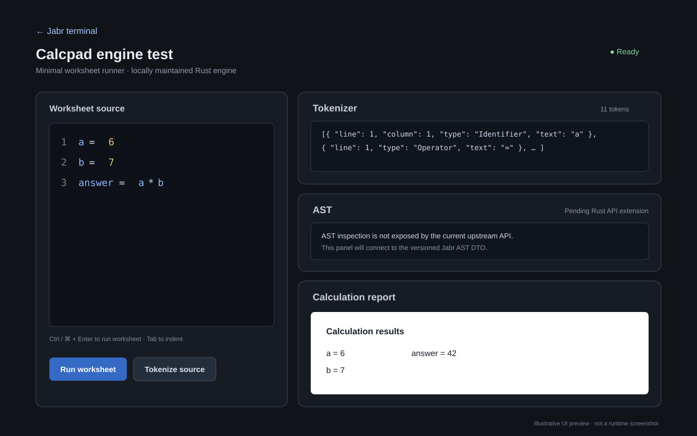

# Jabr Math

Jabr Math is the mathematical language and calculation subsystem of the Jabr engineering worksheet ecosystem. This repository currently hosts a development workbench, the locally maintained Calcpad Rust source, its native/WASM adapters, and the separate Mathlex compatibility experiment. The workbench is for engine development and is not the production worksheet UI.

The vendored Calcpad source is maintained locally under engine/. It is a selected source import from CivilKit Calcs, not a runtime API or Git submodule dependency. Preserve upstream license, NOTICE and provenance files.

## Ecosystem architecture boundary

- **Jabr Math owns:** mathematical syntax, parsing, AST, values, quantities, units, dimensional rules, and expression evaluation.
- **Jabr-engine owns:** worksheet node mapping, graph construction, binding, dependency resolution, recalculation scheduling, and calculation-result lifecycle. The repository is planned but does not yet exist.
- **Jabr-kernel owns:** generic NodeId/Port, Revision, Snapshot<T>, ResultStore<V>, dependency-graph primitives, diagnostics and spans. It does not own Math values or variable semantics.
- **Jabr-table owns:** table structure, stable row/column IDs, typed table data and data operations. A dedicated authored formula-source contract remains to be designed; Math parses authored expressions and Table never evaluates them.
- **Jabr-UI owns:** the complete BlockSuite/MathLive product experience and authored document persistence. Computed results remain derived/transient and are not written into Yjs.

Math currently exposes an initial Jabr-owned source-evaluation facade over the vendored Calcpad core. It returns report HTML and line-oriented MathDiagnostic values; it does not yet expose structured Math values, Engine-owned variable snapshots or a versioned browser wire protocol. Math must not become the worksheet orchestrator or own cross-engine scheduling. Its current Calcpad workbench and Mathlex terminal remain development tools, not a second product UI.

**Naming note:** the `jabr-engine` binary built inside `engine/calcpad-core` is the native Calcpad worksheet test runner for this repository. It is not the separate, planned `Jabr-engine` worksheet orchestration repository listed above.


The legacy terminal is a simulated application terminal, **not** an operating-system shell. It executes only commands registered by the host application. It does not execute arbitrary JavaScript or Windows commands.

## Quick start

Requirements: Git, Bun, Rust (rustup/Cargo), wasm-pack **0.15.1**, the `wasm32-unknown-unknown` target, and Python 3.10+ for independent CLI checks.

```bash
bun install --frozen-lockfile && bun run dev:bun  # npm alternative: npm install && npm run dev
```

Open [http://localhost:5173/](http://localhost:5173/) for the original terminal or [http://localhost:5173/engine-test.html](http://localhost:5173/engine-test.html) for the Calcpad engine test page.

Install Bun from https://bun.sh/docs/installation, then install the pinned wasm-pack release:

```bash
cargo install wasm-pack --version 0.15.1 --locked
rustup target add wasm32-unknown-unknown
```

The npm command is a convenience fallback for running the Node-based package scripts; **Bun remains the canonical package manager and `bun.lock` is the only committed JavaScript lockfile**.

## Media preview

The following is an illustrative layout preview of the minimal engine test page. The live page is generated by the local Rust/WASM engine; the AST panel intentionally reports the current Rust API limitation rather than fabricating an AST.



## Project documentation

- [Development guide](docs/DEVELOPMENT.md) — architecture, setup, build workflow, testing strategy, and AST inspector design.
- [Agent instructions](AGENTS.md) — repository-wide rules and constraints for AI coding agents.
- [Contributing guide](CONTRIBUTING.md) — branch, coding, testing, and pull-request expectations.
- [Engine-lab development plan](docs/ENGINE-LAB-PLAN.md) — milestones, API contract, and acceptance criteria.
- [Public Rust API and Kernel boundary](docs/api/PUBLIC-RUST-API-AND-KERNEL-BOUNDARY.md) — current source-evaluation facade and generic Kernel/Engine ownership contract.
- [CivilKit API audit](docs/CIVILKIT-API-AUDIT.md) — current upstream API findings.
- [Tokenizer and AST design](docs/TOKENIZER-AST-DESIGN.md) — tokenizer/AST distinction and proposed inspection contract.

## Stack

- Vanilla HTML and CSS
- TypeScript and Vite (no React or frontend framework)
- Locally vendored Calcpad Rust core and supporting crates under `engine/`
- Jabr-owned native worksheet runner for native build/smoke testing
- Vendored Calcpad WebAssembly engine via wasm-pack/wasm-bindgen
- CivilKit tokenizer/highlighter WebAssembly package (upstream `calcpad-highlighter-wasm`)
- Existing Mathlex parser bridge retained temporarily for the original terminal commands
- KaTeX and MathJax for the original terminal's mathematical typesetting
- CodeMirror worksheet editor
- Vitest and Cargo tests
- Python standard-library black-box regression checks
- Bun as the sole JavaScript package manager

## Build workflow

The full build deliberately follows this order:

1. **Native runner:** compile Jabr's local `jabr-engine` binary and run a small worksheet smoke test.
2. **WebAssembly:** compile CivilKit's `calcpad-wasm` and `calcpad-highlighter-wasm` crates for `wasm32-unknown-unknown` and generate browser bindings; then build the existing Mathlex compatibility bridge.
3. **Vite:** type-check TypeScript and build both browser pages.

Bun commands:

```bash
bun install --frozen-lockfile
bun run build:bun
bun run dev:bun
```

The native and WASM stages can also be run separately with `bun run engine:native:bun` and `bun run engine:wasm:bun`.

## Minimal Calcpad engine test page

The page at `/engine-test.html` has a worksheet editor, Run button, tokenizer inspection (upstream token type/text/source positions), an AST status panel, engine status/version, rendered report and calculation messages. Tokenization uses CivilKit's separate highlighter WASM package. The page calls CivilKit's existing `convert` API through WebAssembly. The generated report is displayed in a sandboxed iframe; scripts in worksheet output are not enabled.

The existing terminal remains at `/`. It continues to use the Mathlex parser bridge while the CivilKit engine is evaluated separately. This is intentional: the test harness validates CivilKit before the terminal's parser/execution architecture is migrated.

## Native CLI smoke test

The native build uses Jabr's local `jabr-engine` runner and a tiny fixture. Run `bun run engine:native:bun`.

The script builds `engine/calcpad-core` and its `jabr-engine` binary, runs it against `tests/fixtures/civilkit-smoke.cpd`, and checks that the generated HTML contains the expected result.

## Independent Python checks

Python is an **external test oracle**, not part of the browser application or Rust engine runtime. After building the native CLI, run:

```bash
python tests/python/run_civilkit_checks.py
```

Or use `bun run test:python`. The initial standard-library test suite checks scalar arithmetic, variable evaluation, operator precedence, and report generation. It computes expected values independently in Python and checks the native Calcpad report. SymPy and NumPy are deliberately deferred until the engine's value/unit/AST output contract is exposed.

## Windows build

After installing the requirements, run `build.ps1` from PowerShell or `build.bat` from Command Prompt. The Windows build scripts install the frozen Bun lockfile and run the full build. PowerShell may require allowing locally created scripts to run for the current user; if so, use `Set-ExecutionPolicy -Scope CurrentUser RemoteSigned` where permitted.

Vite binds to `127.0.0.1` by default. It binds to `0.0.0.0` only in GitHub Codespaces so the development server can be forwarded. The production build writes both pages to `dist/`.

## Existing terminal commands

```text
help
math 2*x + sin(y)^2
math-latex \\frac{1}{2}
ast 2*x + sin(y)^2
ast-latex \\frac{1}{2}
echo hello
version
about
clear
```

The math commands consume the raw text after the command name. LaTeX backslashes are preserved exactly; no doubled backslashes, quotes, or shell-style escaping are required. Existing outer quotes remain accepted for compatibility.

The Mathlex bridge parses expressions and serializes its AST to LaTeX. It does not evaluate worksheets. The Calcpad test page is the first integration of a full calculation engine. The Mathlex AST/LaTeX commands are not yet evidence that Calcpad exposes the same outputs.

## Tests

```bash
bun run test
bun run typecheck:bun
bun run build:bun
bun run test:wasm
python tests/python/run_civilkit_checks.py
cargo test --manifest-path engine/Cargo.toml -p jabr-calcpad-core
cargo test --locked --manifest-path rust/mathlex-bridge/Cargo.toml
```

CI runs the Windows native build and Python checks, the vendored Rust test suites, and the WebAssembly integration and Vite build using Bun.

## Project structure

```text
.
├── AGENTS.md
├── CONTRIBUTING.md
├── docs/
│   ├── media/                 # README preview assets
│   ├── DEVELOPMENT.md
│   └── ENGINE-LAB-PLAN.md
├── engine/                    # Locally vendored Calcpad crates, native runner, and WASM wrappers
├── rust/mathlex-bridge/       # Temporary parser bridge for the original terminal
├── scripts/                   # Native and WASM build scripts
├── src/
│   ├── editor/                # CodeMirror worksheet editor
│   ├── engine/                # Terminal engine and generated WASM bindings
│   ├── command/               # Built-in terminal commands
│   └── interactive/           # Terminal UI and minimal engine test UI
├── tests/
│   ├── fixtures/
│   └── python/                # Independent Python CLI checks
├── index.html                 # Existing terminal
└── engine-test.html           # Minimal Calcpad calculation test page
```

## Upstream and licensing

CivilKit Calcs is MIT-licensed and is itself a derivative of the MIT-licensed CalcpadCE project. Its upstream `LICENSE` and `NOTICE` are retained under `engine/`. Preserve those notices in any redistributed build. See https://github.com/civilkit/civilkit-calcs for upstream source and history.

The vendored source was imported from CivilKit Calcs revision `97f4bb698cea3bd6a9a4fae46dbc28b0d3ca5ffc`. See [`engine/UPSTREAM.md`](engine/UPSTREAM.md) for crate mapping, provenance, and licensing.

## Safety boundary

The legacy terminal is an application command interface, not a system shell. Input is dispatched only to registered commands. It does not use `eval()` or run operating-system processes.
